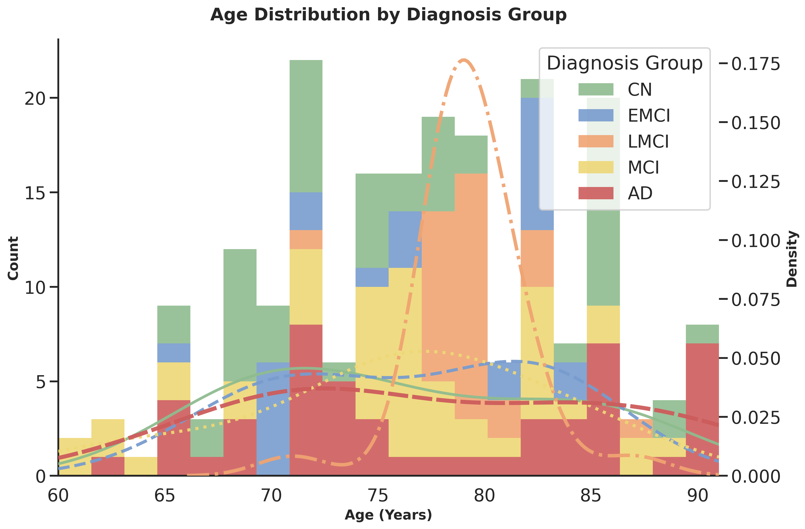
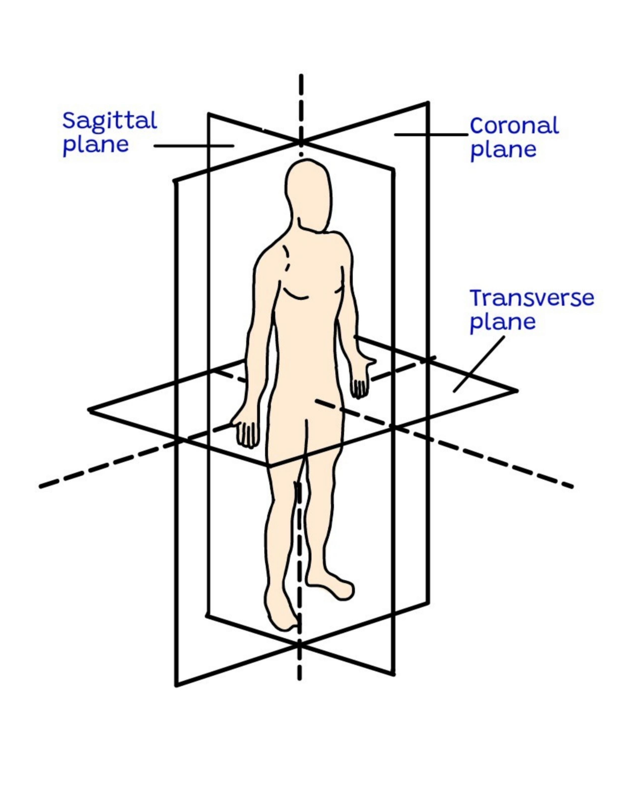
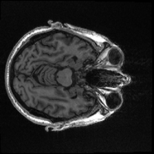
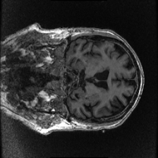
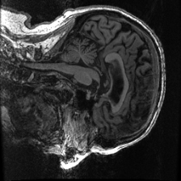
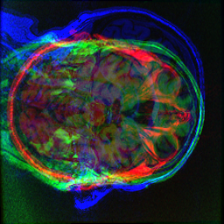
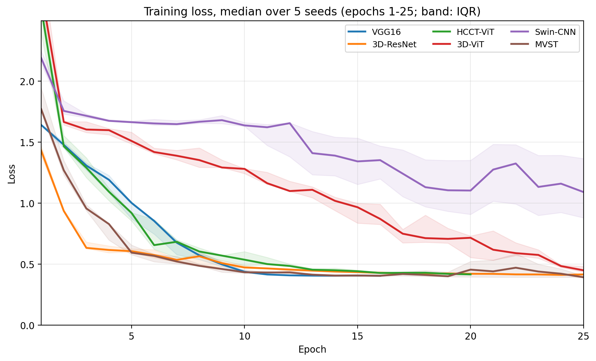
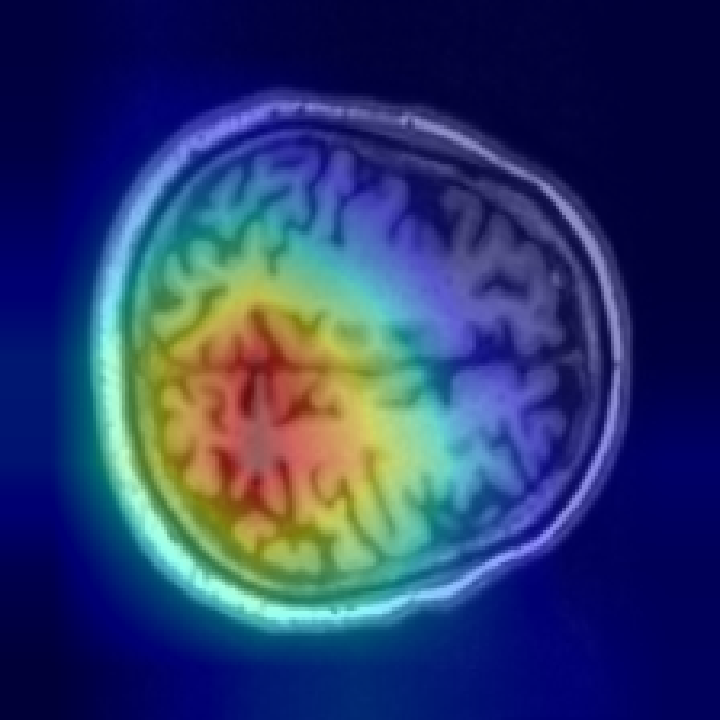
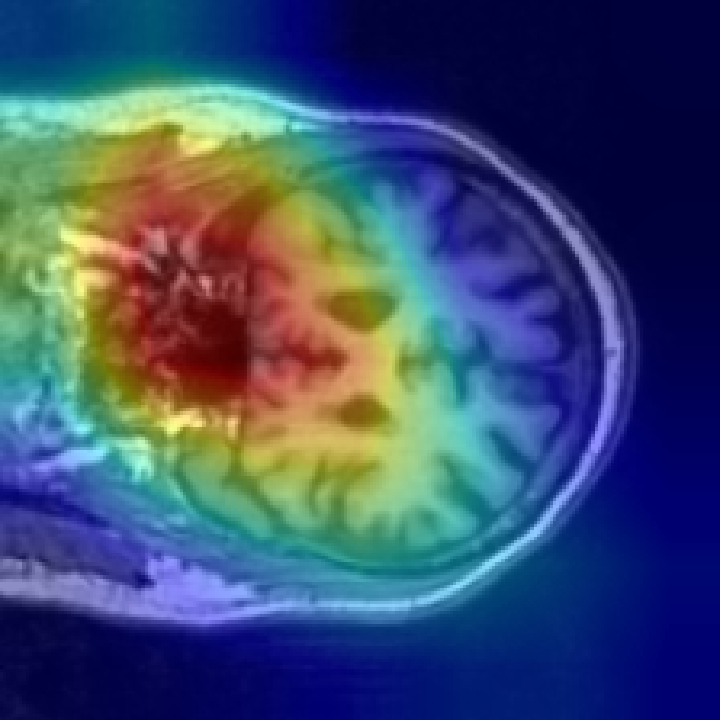
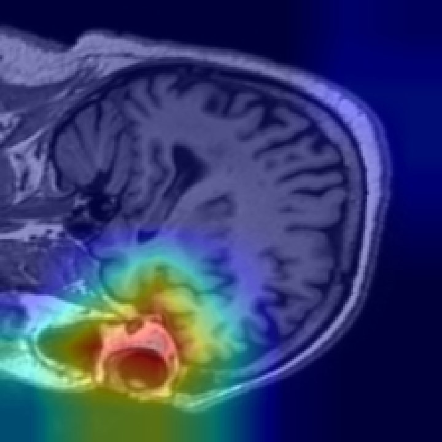

# AD Detection

Five-class ADNI MRI classification (CN / MCI / EMCI / LMCI / AD) with 2D/3D CNN and transformer models.

## Setup

```
1. >> create a env based on Python version = 3.12

2. >> pip install -r requirements.txt

-- if it dont work, try step4

3. >> bash scripts/download_dataset.sh

4. >> pip install torch==2.5.0 torchvision==0.20.0 torchaudio==2.5.0 --index-url https://download.pytorch.org/whl/cu121
```

## Experimental Protocol

- 205 ADNI MRI scans, 5 classes. Subject-level split: 159 / 14 / 32 scans, no subject overlap.
- 3D models: `32 x 112 x 112` volumes. VGG16: three `224 x 224` slices.
- Adam, lr `1e-4`, weight decay `1e-4`, batch 8, max 50 epochs, early stopping, AMP.
- Checkpoint selection: best validation macro-F1; label smoothing 0.1; ResNet dropout 0.3.
- Deep results: best seed and mean ± std over seeds 42-46 on the test split.
- Traditional ML: best variant of each family (RF / SVM / LogReg) over Age/Sex, 3-view, and single-slice PCA-256 features.
- Test set has 32 scans; EMCI and LMCI have 1 scan each, so std is large by construction.

Age distribution across diagnostic groups:



## Project Structure

```
.
|-- AGENTS.md                 # Agent instructions
|-- README.md
|-- requirements.txt
|-- train.py                  # Training CLI
|-- test.py                   # Evaluation CLI
|-- scripts/                  # Helper tools
|-- models/                   # Model implementations
|-- utils/                    # Dataset and metrics
|-- configs/                  # Configs and subject-level splits
|-- assets/                   # Slice examples
|-- notebooks/                # Notebooks
|-- results/                  # Reports and run logs
|-- logs/                     # Logs
|-- cache/                    # Preprocessed arrays (ignored)
|-- outputs/                  # Runtime outputs (ignored)
|-- figures/                  # Tracked figures
|-- dataset/                  # ADNI data (ignored)
`-- checkpoints/              # Weights (ignored)
```

## Supported Models

Configs in `configs/training/`:

* **VGG16**: 2D transfer learning.
* **3D-ResNet**: 3D CNN.
* **HCCT-ViT**: Hybrid compact convolution transformer.
* **3D-ViT**: 3D vision transformer.
* **Swin-CNN**: Swin transformer + 3D CNN.
* **MVST**: Multi-view slice transformer (ImageNet CNN tokens + transformer).

VGG16 input stacks the three slices below.

<p align="center">
  
</p>

<p align="center">
  
  
  
  
</p>

## Usage

Commands (run from repo root):

```bash
python train.py --model resnet
python train.py --model vgg16 --epochs 50 --lr 1e-4
python test.py --model resnet --split test
python scripts/ml_baselines.py --source image --model random_forest --pca-components 256
bash scripts/run_ml_baselines.sh
python scripts/gradcam.py --split test --index 0
python scripts/generate_splits.py
python scripts/metadata_ml_baseline.py --help
python scripts/plot_age_distribution.py
python scripts/plot_age_distribution_blue.py
python scripts/preview_views.py
```

Run `python train.py --help` or `python test.py --help` for all options.

Full experiment pipeline:

```bash
python scripts/build_cache.py
PYTHON=$PY bash scripts/run_ml_baselines.sh
bash scripts/run_all_experiments.sh   # 6 models x 5 seeds
python scripts/collect_results.py
python scripts/plot_losses.py
```

## Results

### Best seed per model

Best of 5 seeds (42-46). This is an optimistic upper bound.

| Method | Params | Acc | F1 | AUC | BAcc | Kappa | MCC | Avg |
| :--- | ---: | ---: | ---: | ---: | ---: | ---: | ---: | ---: |
| 3D-ResNet | 33.2 M | 40.62 | 49.58 | 72.37 | 59.00 | 12.77 | 13.90 | 41.37 |
| 3D-ViT | 88.6 M | 40.62 | 37.45 | 66.28 | 43.33 | 16.02 | 20.07 | 37.30 |
| VGG16 (2D-TL) | 134.3 M | 34.38 | 39.47 | 63.50 | 58.00 | 9.19 | 16.78 | 36.89 |
| MVST | 24.1 M | 37.50 | 33.68 | 71.14 | 42.33 | 12.57 | 13.30 | 35.09 |
| Swin-CNN | 27.6 M | 34.38 | 30.26 | 68.27 | 40.00 | 7.18 | 14.51 | 32.43 |
| HCCT-ViT | 30.2 M | 34.38 | 28.67 | 61.91 | 39.00 | 5.35 | 6.05 | 29.23 |
| RF (single-slice, PCA256) | -- | 21.88 | 32.53 | 60.65 | 32.33 | -11.27 | -12.00 | 20.69 |
| SVM (3-view, PCA256) | -- | 25.00 | 8.00 | 50.00 | 20.00 | 0.00 | 0.00 | 17.17 |
| LogReg (single-slice, PCA256) | -- | 15.62 | 9.52 | 53.23 | 12.50 | 4.11 | 6.01 | 16.83 |

<details>
<summary>Mean ± std over 5 seeds</summary>

| Method | Params | Acc | F1 | AUC | BAcc | Kappa | MCC | Avg |
| :--- | ---: | ---: | ---: | ---: | ---: | ---: | ---: | ---: |
| MVST | 24.1 M | 30.00 ± 5.23 | 32.80 ± 7.99 | 67.61 ± 3.09 | 45.23 ± 9.86 | 5.19 ± 5.45 | 6.07 ± 5.76 | 31.15 |
| 3D-ResNet | 33.2 M | 30.63 ± 7.46 | 27.77 ± 12.43 | 69.98 ± 2.06 | 33.43 ± 15.57 | 2.71 ± 8.28 | 3.05 ± 9.02 | 27.93 |
| 3D-ViT | 88.6 M | 29.38 ± 9.00 | 27.49 ± 7.56 | 63.95 ± 2.98 | 32.63 ± 8.55 | 0.30 ± 11.22 | 0.68 ± 13.27 | 25.74 |
| VGG16 (2D-TL) | 134.3 M | 30.63 ± 8.38 | 19.49 ± 11.33 | 63.46 ± 2.20 | 26.27 ± 18.02 | 1.38 ± 7.53 | 4.16 ± 11.67 | 24.23 |
| HCCT-ViT | 30.2 M | 26.87 ± 7.20 | 27.24 ± 6.52 | 62.47 ± 3.10 | 34.57 ± 4.05 | -3.46 ± 8.09 | -3.61 ± 8.60 | 24.01 |
| RF (single-slice, PCA256) | -- | 21.88 | 32.53 | 60.65 | 32.33 | -11.27 | -12.00 | 20.69 |
| Swin-CNN | 27.6 M | 25.00 ± 10.60 | 12.62 ± 9.98 | 66.10 ± 3.20 | 20.20 ± 11.87 | -5.01 ± 10.48 | -5.80 ± 14.76 | 18.85 |
| SVM (3-view, PCA256) | -- | 25.00 | 8.00 | 50.00 | 20.00 | 0.00 | 0.00 | 17.17 |
| LogReg (single-slice, PCA256) | -- | 15.62 | 9.52 | 53.23 | 12.50 | 4.11 | 6.01 | 16.83 |

</details>

The 32-scan test set (EMCI/LMCI = 1 scan each) makes seed variance large; the mean ± std table is the more honest estimate. Aggregated results: `results/final_metrics.md`, `results/best_metrics.md`, and `results/deep_metrics.csv`.

## Training Curves

Training loss over 5 seeds, first 25 epochs (line: median, band: IQR; one color per method). All models use batch 8, lr `1e-4`.



## Attention Case Study

MVST Grad-CAM for an AD test case (true=AD, pred=AD). Overlay: jet, normalized 0-1.

<p align="center">
  
  
  
</p>
